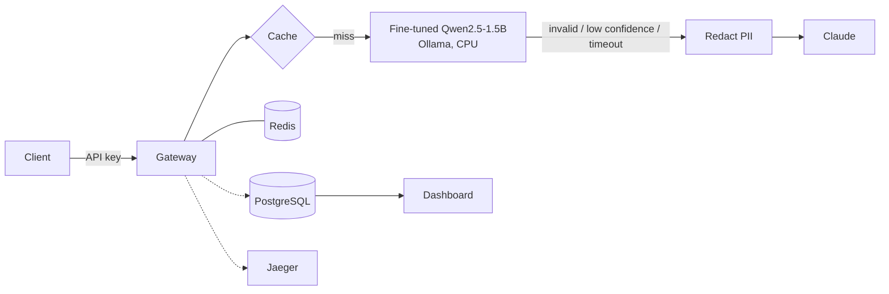

# LogLens

LogLens triages system and network logs. For each log line it returns a severity, a category, a
short root-cause explanation and a suggested action, always as schema-valid JSON. A small
fine-tuned model handles most traffic on a CPU; Claude handles only the lines the small model isn't
sure about.

**Live demo:** [TO BE FILLED AFTER DEPLOY] · **Design doc:** [docs/DESIGN.md](docs/DESIGN.md)

```
POST /v1/triage  {"message": "Failed password for invalid user admin from 203.0.113.7 port 52211 ssh2", "source": "openssh"}

{"severity": "<info|warning|error|critical>", "category": "<auth|network|disk|memory|service|security|other>",
 "root_cause": "...", "suggested_action": "...",
 "provider": "local|claude", "confidence": <0-1>, "cache": "miss|exact|semantic", "fallback_reason": ..., ...}
```

## What's in it

| Part | What it does | Where |
|---|---|---|
| Data | Loghub (Linux, OpenSSH, Apache, BGL) parsed, masked, grouped into Drain templates; Claude labels batches against a JSON schema with caching and spend limits; Streamlit review tool; template-grouped splits with near-duplicate removal against the golden set | [src/loglens/data](src/loglens/data), [docs/DATA.md](docs/DATA.md) |
| Fine-tuning | QLoRA (4-bit NF4 + LoRA r=16) of Qwen2.5-1.5B-Instruct with TRL on a free Colab T4; merge, GGUF export, Ollama | [training](training), [docs/FINETUNING.md](docs/FINETUNING.md) |
| Evals | golden set vs base / fine-tuned / Claude: accuracy, macro F1, valid-JSON rate, latency, cost, LLM-as-judge with rubric and human agreement, confusion matrices, error analysis | [src/loglens/evals](src/loglens/evals) |
| Gateway | FastAPI, OpenAI-compatible endpoint, confidence routing with fallback, retries, circuit breakers, auth, rate limits, budgets, PII redaction, exact + semantic cache, request logging | [src/loglens/gateway](src/loglens/gateway) |
| LLMOps | versioned prompts, MLflow model registry, canary routing and comparison, OpenTelemetry tracing, dashboard, CI with an eval regression gate | [docs/LLMOPS.md](docs/LLMOPS.md) |
| Deployment | Docker Compose (gateway, Ollama, Redis, Postgres, MLflow, Jaeger, dashboard), load test, Hugging Face Space | [infra](infra), [deploy/hf_space](deploy/hf_space) |
| Learning | a small transformer written from scratch (attention, multi-head, positional encoding) | [learning/mini_transformer](learning/mini_transformer) |

## Architecture



The request flow, routing logic, caching, failure handling and scaling plan are in
[docs/DESIGN.md](docs/DESIGN.md).

## Results

Every number here comes from a run in this repository. Rows that haven't been run yet say so.

### Golden-set eval

| System | Severity acc | Severity macro F1 | Category acc | Category macro F1 | Valid JSON | p95 latency | API cost / 1k req | Judge (1-5) |
|---|---|---|---|---|---|---|---|---|
| Qwen2.5-1.5B base + prompt | [TO BE FILLED AFTER RUN] | | | | | | $0 | |
| Qwen2.5-1.5B QLoRA | [TO BE FILLED AFTER RUN] | | | | | | $0 | |
| Claude (fallback model) | [TO BE FILLED AFTER RUN] | | | | | | | |

Golden set: [TO BE FILLED AFTER RUN] human-reviewed lines, never used in training. Full report:
`reports/eval/latest.md`.

### Base model, measured before fine-tuning

Label-free benchmark (no accuracy), 100 sample lines, Qwen2.5-1.5B-Instruct Q4_K_M, Ollama in Docker
on a Windows laptop CPU with 8 threads ([reports/label_free](reports/label_free)):

| Valid JSON (tolerant parser) | Wrapped in markdown fences | p50 latency | p95 latency | Median confidence | Lines below 0.70 confidence |
|---|---|---|---|---|---|
| 100% | 98% | 2.57 s | 3.70 s | 0.64 | 60% |

Two things follow from this. A strict `json.loads` would have rejected 98% of the base model's
answers, which is why the parser finds the JSON object first. And at the default threshold, 60% of
traffic would fall back to Claude. Fine-tuning is meant to bring that number down; the eval above
measures whether it did.

Engineering finding from the same setup: llama.cpp with one thread per vCPU (16 on an 8-core
machine) generated ~0.5 tokens/s; 8 threads gave ~32 tokens/s. The thread count is now an explicit
setting (`LOGLENS_OLLAMA_THREADS`).

### Load test

Full Compose stack on one laptop, **base** model on CPU, no Claude fallback, 8 Locust users for
5 minutes with a repetitive traffic mix ([details and raw CSVs](reports/loadtest)):

| Requests | Throughput | Cache hit rate | p50 | p50 exact / semantic hit | p99 | Errors |
|---|---|---|---|---|---|---|
| 861 | 2.87 req/s | 89.1% | 13 ms | 7 ms / 72 ms | 20 s | 1.05% (503) |

The cache absorbs most traffic. Cache misses queue behind a single CPU model, and that queue
produces the whole latency tail and every error. A first run that retried local timeouts had a
40 s worst case. Retrying put the same work back on an overloaded model, so local timeouts now fail
over instead of retrying.

## Quick start

Requirements: Python 3.12, Docker Desktop. No GPU needed (training runs on Colab).

```powershell
git clone <this repo>; cd loglens
python -m venv .venv; .\.venv\Scripts\Activate.ps1
./tasks.ps1 install                  # or: make install (WSL/Linux)
copy .env.example .env               # set LOGLENS_API_KEYS; ANTHROPIC_API_KEY is optional
./tasks.ps1 check                    # lint + tests (no network, no API calls)
docker compose -f infra/docker-compose.yml up -d --build
```

| Service | URL |
|---|---|
| Gateway API + docs | http://127.0.0.1:8000/docs |
| Dashboard | http://127.0.0.1:8501 |
| MLflow | http://127.0.0.1:5000 |
| Jaeger | http://127.0.0.1:16686 |

On Windows use `127.0.0.1` rather than `localhost`: `localhost` tries IPv6 first, and Docker Desktop's port
forward is IPv4-only, which added ~2 s to every new connection in testing.

```powershell
$key = "<one of LOGLENS_API_KEYS>"
curl.exe -s http://127.0.0.1:8000/v1/triage -H "Authorization: Bearer $key" -H "Content-Type: application/json" `
  -d '{\"message\": \"Out of Memory: Killed process 2592 (httpd).\", \"source\": \"linux\"}'
```

### Reproducing the pipeline

```powershell
./tasks.ps1 data                       # download + parse + sample (free)
./tasks.ps1 label -N 50                # dry run: shows the prompt and the cost estimate
./tasks.ps1 label -N 50 -Args "--no-dry-run"   # pilot: label 50 lines (asks before spending)
./tasks.ps1 golden; ./tasks.ps1 review # pick and review the golden set in Streamlit
./tasks.ps1 split; ./tasks.ps1 stats   # leakage-safe splits + reports/data_stats.md
# train on Colab: training/loglens_qlora.ipynb (see docs/FINETUNING.md)
./tasks.ps1 eval -Args "--systems base,finetuned,claude --judge"
```

### Load test

```powershell
pip install -e ".[loadtest]"
$env:LOGLENS_API_KEY = "<key>"
locust -f infra/loadtest/locustfile.py --host http://127.0.0.1:8000 --headless -u 8 -r 2 -t 5m --csv reports/loadtest/run
curl.exe -s http://127.0.0.1:8000/v1/stats -H "Authorization: Bearer $env:LOGLENS_API_KEY"   # cache hit rate
```

## Screenshots

[TO BE ADDED: dashboard, Jaeger trace of a fallback request, eval report]

## Limitations

- Labels come from Claude plus one human reviewer, so category boundaries are noisy.
- One line at a time: patterns that span many lines (bursts, cascades) aren't detected.
- Training logs are from 2005-2009 systems; JSON or Kubernetes logs aren't covered.
- The confidence threshold is tuned on validation data, not calibrated with a fitted curve.
- The public demo runs on 2 shared vCPUs without the Claude fallback, so it's slower and returns
  low-confidence answers as-is.

## Future work

- RAG over runbooks and past incidents for the suggested-action field.
- Windowed aggregation for multi-line incidents.
- vLLM on GPU with a queue in front for high-volume batch triage (see DESIGN.md §10).
- Calibration curve for confidence, and a learned router instead of a fixed threshold.

## License

MIT. Log data: [Loghub](https://github.com/logpai/loghub) (research use), downloaded by script and
not redistributed here.
