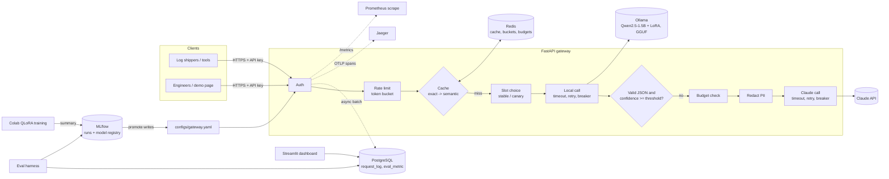

# LogLens system design

## 1. Problem

On-call engineers read a lot of log lines. For each one they decide how severe it is, which
subsystem it concerns, what probably happened, and what to do next. LogLens automates that first
pass, producing validated JSON that downstream tools such as alerting, ticketing and dashboards can
consume.

Constraints that drive the design:

- **Volume and cost.** Most lines are routine. Sending every line to a frontier model is expensive
  and slow.
- **Privacy.** Logs contain IPs, hostnames, usernames and sometimes secrets. Only what's necessary
  should leave the network, and it must be redacted.
- **Reliability.** Output must be machine-readable every time, and the service must degrade, not
  fail, when a model is down.

## 2. Architecture

## 3. Request flow (`POST /v1/triage`)

1. **Auth.** The API key comes from `Authorization: Bearer` or `X-API-Key`. Its SHA-256 hash is
   compared in constant time, and only a 12-character hash (`key_id`) is used afterwards.
2. **Rate limit.** A Redis token bucket per key, implemented as a Lua script so check-and-decrement
   is atomic across gateway replicas. A batch of N lines costs N tokens. Rejections return `429`
   with `Retry-After`.
3. **Cache.** Each request is assigned a slot (stable or canary, by hashing the request id). It then
   checks the exact cache (sha256 of the raw line), then the semantic cache (embedding of the masked
   line, cosine similarity ≥ 0.95). Cache keys are namespaced by prompt version and model version.
4. **Token budget.** A daily token budget per key is checked before any model call.
5. **Local model.** Ollama `/api/chat` at temperature 0 with token log-probabilities. The call has a
   timeout, jittered exponential backoff on connection errors (not on timeouts; see §8), and a
   circuit breaker per provider.
6. **Trust decision.** The output is parsed tolerantly (first balanced JSON object, so markdown fences
   are fine), validated strictly with Pydantic (enums, required fields, no extra keys), then scored
   for confidence.
7. **Fallback.** The request falls back to Claude on `invalid_json`, `low_confidence`, `timeout`,
   `local_unavailable`, `circuit_open` or `local_error`. Before calling out, the gateway checks the
   key's daily USD budget, then redacts PII and secrets. Claude's answer is schema-constrained
   (`output_config.format`), validated, and placeholders are mapped back to the original values for
   the caller.
8. **Degrade, don't fail.** If the fallback is unavailable, over budget or disabled, the local answer
   is returned with `degraded: true`. A `503` is returned only when no provider produced anything.
9. **Record.** The cache stores trusted answers only. The request log row (provider, model and
   prompt version, slot, tokens, latency, cost, cache result, fallback reason, confidence, number of
   redactions) goes onto an in-memory queue and is written to PostgreSQL in batches by a background
   task. Prometheus counters and OTel spans are updated.

## 4. Confidence and routing

**Method (default): token log-probabilities.** For the first token of the `severity` value and the
first token of the `category` value, take the probability the model assigned when it committed to
that class. Confidence = min of the two. It's free (one call), and Ollama 0.40 returns per-token
logprobs.

**Alternative: self-consistency.** Sample N more answers at temperature 0.7; confidence = share that
agree with the greedy answer on both fields. Usually better calibrated, but N times the CPU.

**Trade-offs and calibration.** Token probabilities from fine-tuned models tend to be overconfident.
The threshold (0.70 by default) is therefore a parameter to tune on the validation split, not a
constant. The trade-off is direct: a higher threshold means more Claude calls (cost, latency, data
leaving the network) and fewer wrong local answers. Measured on the **base** model (100 sample lines,
before fine-tuning): median confidence 0.64, and 60% of lines fell below 0.70. With the base model,
most traffic would go to Claude, which is the cost argument for fine-tuning.

## 5. Caching strategy and staleness

| Layer | Key | TTL | Serves |
|---|---|---|---|
| Exact | sha256(raw line) in namespace `{prompt}:{model}` | 24 h | the identical line |
| Semantic | embedding of masked line (all-MiniLM-L6-v2), cosine ≥ 0.95 | 6 h | same event with different IPs, users or numbers |

- **Staleness.** Answers can go stale when the model, prompt or label definitions change. The
  namespace includes prompt and model version, so promotion starts with a cold cache automatically.
  TTLs bound staleness otherwise. The semantic layer has a shorter TTL because its hits are
  approximate.
- **Privacy.** A semantic hit serves a *different* line, so the stored explanation is PII-scrubbed
  first. One request's IP or username can never appear in another request's answer. Exact hits are
  safe because the answer was produced from the identical input.
- **What is not cached.** Degraded or low-confidence answers, so a later request gets a chance at a
  better answer.
- **Scale limit.** Semantic lookup is a brute-force cosine over the newest N entries (5,000 by
  default). Beyond that it becomes a Redis vector index (HNSW) or a vector database.

## 6. Fine-tune vs prompt vs RAG

| Option | Strengths | Weaknesses | Used for |
|---|---|---|---|
| Prompt a frontier model | best quality, no training | cost per line, latency, data leaves network | fallback; teacher for labels; judge |
| Prompt a small local model | free per request, private | weak format adherence and calibration (measured: 98% of answers wrapped in markdown, 60% low confidence) | baseline only |
| Fine-tune a small model (QLoRA) | cheap, private, learns our label definitions and format | needs labeled data, retraining when definitions change | primary path |
| RAG | brings in fresh or organisation-specific knowledge (runbooks, past incidents) | retrieval infrastructure; doesn't fix format or classification | future work, for the suggested-action field |

## 7. Cost vs quality routing

Expected cost per request ≈ (fallback rate) × (Claude cost per call). The local model's marginal API
cost is zero; its real cost is the hardware. The levers are:

- **Confidence threshold.** Directly trades fallback rate against error rate.
- **Cache hit rate.** Every hit is a request that costs nothing.
- **Fallback model.** Opus 5.5 by default. Haiku 5.5 is ~40x cheaper per token; whether it's good
  enough is a question for the eval harness, not a guess.
- **Per-key USD budgets.** These cap the worst case regardless of traffic.

The eval report gives cost per 1,000 requests for each system, so the decision is based on measured
numbers.

## 8. Failure modes

| Failure | Detection | Handling |
|---|---|---|
| Local model slow or hung | per-attempt timeout | fall back immediately (`timeout`); no retry, because in the load test retrying timeouts re-queued work on an overloaded model and doubled the worst case to 40 s |
| Local model overloaded (queue) | latency, timeouts | today: timeouts → fallback; next step: load shedding (skip local when its in-flight count is high) |
| Local model down | connection error, `/readyz` | breaker opens after 5 failures; fall back (`circuit_open`) without waiting |
| Local model outputs garbage | parse/validation failure | fall back (`invalid_json`) |
| Local model unsure | confidence < threshold | fall back (`low_confidence`) |
| Claude down / rate limited | 5xx, 429, timeout | own breaker; return local answer as `degraded` |
| Claude refuses | `stop_reason == "refusal"` | treated as a provider error; return degraded local answer |
| Budget exhausted | Redis counters | skip fallback (`+budget_exhausted`); token budget returns `429` |
| Redis down | connection errors | `/readyz` fails so the load balancer drains the instance |
| PostgreSQL down | write exception | rows dropped and counted (`/v1/stats`); serving unaffected |
| Bad deploy (new model/prompt) | canary comparison, CI gate | canary slot at small %, compare before promote; config rollback is a git revert |
| Shutdown mid-traffic | SIGTERM | uvicorn drains in-flight requests (20 s), then the log queue is flushed |

## 9. Security and privacy

- API keys in env/`.env` only (`.env` gitignored), compared as hashes in constant time, never logged.
- PII/secret redaction before any external call: IPv4/IPv6, MAC, emails, hostnames (Java class names
  excluded), usernames in common sshd/PAM phrasings, `key=value` secrets, bearer tokens, known token
  formats (AWS, GitHub, Slack, JWT, `sk-`), private key blocks. Covered by unit tests, including real
  sample lines.
- Request log stores metadata, not log text. Spans carry no log text.
- Containers run as non-root. Compose binds ports to `127.0.0.1`.
- The public demo uses a deliberately public key with tight rate limits and no paid fallback.
- Not done (would be needed for production): TLS termination, key rotation and scopes, per-tenant
  data isolation in Postgres, audit logging, a secrets manager.

## 10. Scaling to millions of logs per day

1M lines/day is ~12 lines/s on average, with peaks perhaps 10x higher. Plan:

1. **Decouple ingestion.** Shippers write to Kafka (or SQS/PubSub). Triage workers consume in
   batches, write results to a topic and a store. The HTTP API stays for interactive use.
2. **Shrink the work before the model.** Mask and dedupe by template (the same masking and Drain
   templates used for the dataset). Most volume is repeats of a few thousand templates, so exact and
   template caches absorb most of it. Only new templates or variants reach a model.
3. **Batch inference on GPUs.** Swap Ollama for vLLM (OpenAI-compatible; the provider already
   exists) on GPU nodes. Continuous batching gives thousands of tokens/s per GPU. Autoscale on queue
   lag (KEDA on Kubernetes) rather than CPU.
4. **Stateless gateways behind a load balancer.** All shared state (buckets, budgets, cache) is in
   Redis, so scaling horizontally is free. Use Redis Cluster at higher volume.
5. **Storage.** Request logs move to a columnar store (ClickHouse/BigQuery) or are sampled.
   PostgreSQL keeps config and eval data.
6. **Multi-region.** Process logs in the region they originate (data residency), with a gateway,
   model and cache per region. Model artifacts are replicated from the registry. The Claude fallback
   respects regional settings.
7. **Cost control at scale.** Per-tenant budgets, a cheaper fallback tier for low-severity sources,
   and offline batch pricing (Anthropic Message Batches, 50% cheaper) for non-urgent backfills.

## 11. Limitations

- Labels come from one teacher model plus one human reviewer, so category boundaries are somewhat
  noisy.
- Lines are judged one at a time. Multi-line patterns (brute-force bursts, cascading failures) need
  windowed aggregation, which is not built.
- Training logs are from 2005–2009 systems. Modern structured logs (JSON, Kubernetes events) are not
  covered.
- Confidence calibration is threshold-based; no calibration curve is fitted yet.
