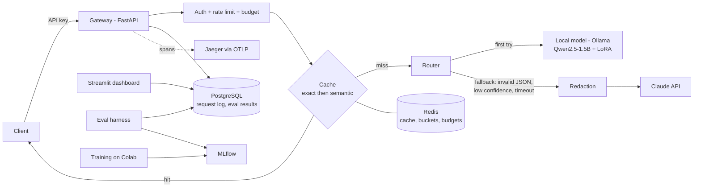

# LogLens project plan

## Goal

Classify log lines by severity and category and explain the likely root cause, using a small
self-hostable model for most traffic and a frontier model (Claude) only when needed. The point is
to show the full path: data, fine-tuning, honest evaluation, a production-style gateway, and the
operational tooling around it.

## Architecture

## Key choices

| Area | Choice | Why |
|---|---|---|
| Base model | Qwen2.5-1.5B-Instruct | Good JSON adherence for its size, Apache-2.0, fits a free T4 for QLoRA and runs on CPU |
| Local serving | Ollama (GGUF, llama.cpp) | Runs on CPU under Windows/WSL. vLLM needs a CUDA GPU, so it is only described for scale-out |
| Teacher / fallback | Claude (smaller tier for labeling and fallback, larger tier as judge) | Cheap labeling at volume, stronger model for grading |
| Tracing | OpenTelemetry + Jaeger | One container, vendor-neutral; Langfuse v3 self-host needs ClickHouse + MinIO |
| Dashboard | Streamlit | Python-only, also reused for the label review tool |
| Live demo | Hugging Face Spaces (CPU, Docker) | Free tier can run the 1.5B GGUF; full stack runs locally with Compose |

## Phases

0. **Setup.** Repo layout, packaging, lint/format, Makefile, this plan.
1. **Dataset.** Download Loghub (Linux, OpenSSH, HDFS, Apache), parse to JSONL, label schema,
   Claude teacher labeling with caching and spend limits, manual review tool, leakage-safe
   train/val/golden split, stats report.
2. **Fine-tuning.** QLoRA notebook + script (TRL SFT), MLflow logging, adapter save, merge,
   GGUF export for Ollama, private HF Hub upload, `docs/FINETUNING.md`. Optional from-scratch
   mini transformer in `learning/`.
3. **Evals.** Golden set against base, fine-tuned and Claude. Accuracy, macro F1, valid-JSON rate,
   latency, cost, LLM-as-judge with rubric and human agreement check. Results to Postgres + MLflow,
   markdown report, confusion matrices, error analysis.
4. **Gateway.** OpenAI-compatible and triage endpoints, provider abstraction, confidence routing
   with fallback, retries/timeouts/circuit breaker, auth, rate limit, budgets, redaction, two-level
   cache, request logging, health/metrics, tests with mocked providers.
5. **LLMOps.** Versioned prompts and models, tracing, canary routing and comparison, dashboard,
   GitHub Actions with an eval regression gate that does not spend API money.
6. **Deployment and design.** Compose stack with healthchecks, load test, `docs/DESIGN.md`,
   final README, Hugging Face Space for the live demo.
7. **Wrap-up.** Full code review, interview questions, resume bullets from measured numbers.

## Things only the owner can do

- Provide `ANTHROPIC_API_KEY` and approve each paid run.
- Review the first 50 teacher labels and ~200 golden-set labels.
- Run the training notebook on Colab/Kaggle and report back the metrics.
- Create the GitHub repo and Hugging Face account/Space, and authenticate pushes.

## Honesty rule

No metric appears in the README or docs unless it came from a run. Pending values are written as
`[TO BE FILLED AFTER RUN]`.
